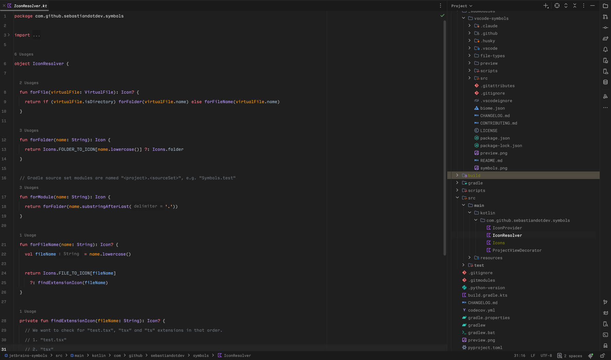
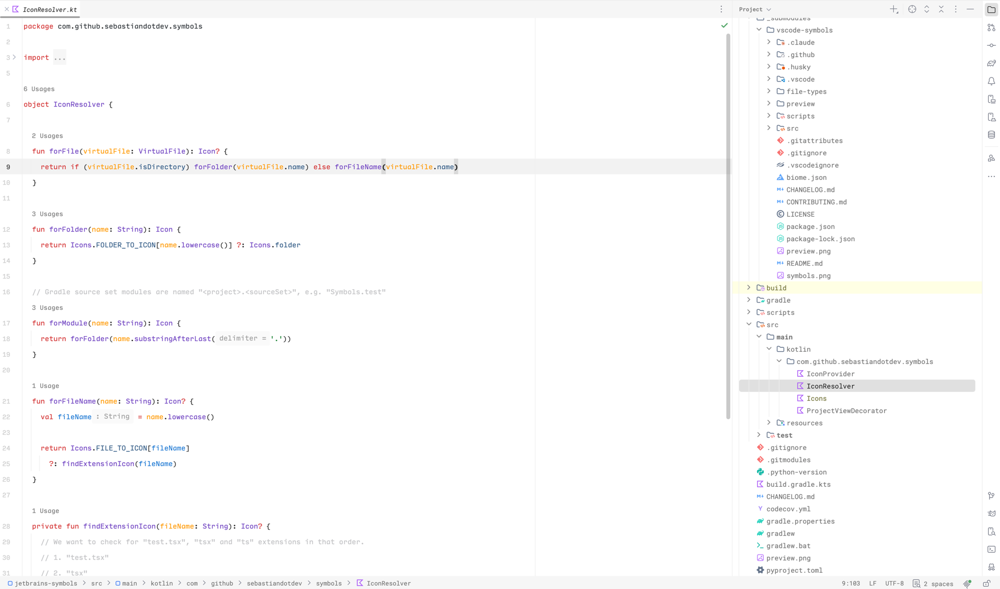

<p align="center">
  
</p>

<h1 align="center">Min Theme for JetBrains</h1>

<p align="center">
  A minimal, distraction-free theme for IntelliJ-based IDEs.<br/>
  Variants: <b>Min Dark</b> · <b>Min Light</b> (+ Islands)
</p>


[](https://github.com/joansgarcia/min-jetbrains/releases/latest)
[](https://plugins.jetbrains.com/plugin/35766-min-theme)
[](https://plugins.jetbrains.com/plugin/35766-min-theme)

Port of [Min Theme](https://github.com/miguelsolorio/min-theme) (Miguel Solorio) to JetBrains IDEs.

## Screenshots

**Min Dark**



**Min Light**



## Installation

### Plugin Marketplace

1. Head to the [Plugin Marketplace](https://plugins.jetbrains.com/plugin/35766-min-theme) (**Settings → Plugins → Marketplace**)
2. Search for "Min Theme"
3. Install Plugin

### Manual

1. Download `Min-Theme-<version>.zip` from the [latest release](https://github.com/joansgarcia/min-jetbrains/releases/latest).
2. In your IDE: **Settings → Plugins → ⚙ → Install Plugin from Disk…** and select the zip.
3. Restart the IDE.

### Activate the theme

**Settings → Appearance & Behavior → Appearance → Theme**: pick *Min Dark* or *Min Light* (the *Islands* variants are also available). The matching editor color scheme is applied automatically; otherwise choose it in **Editor → Color Scheme**.

Compatible with IntelliJ-based IDEs, builds 231 – 262.*.

## Structure

```
palettes/                  # source of truth: colors per variant (from the VS Code theme)
scripts/generate.py        # palettes -> src/main/resources/themes/*.theme.json + *.xml
src/main/resources/
  META-INF/plugin.xml      # themeProvider + bundledColorScheme
  themes/                  # generated UI theme + editor color scheme
.run/                      # IDE run configurations
```

## Development

```sh
python3 scripts/generate.py   # regenerate themes after editing palettes/
./gradlew runIde              # try it in a sandbox IDE
./gradlew buildPlugin         # build/distributions/*.zip
```

Requires JDK 21.

## License

MIT. Original theme © Miguel Solorio.
